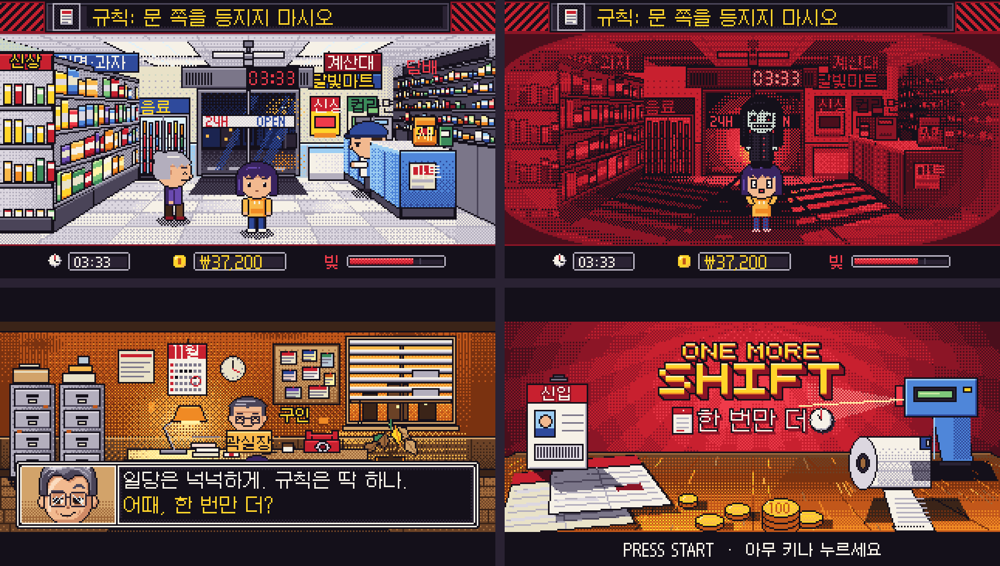

# ONE MORE SHIFT · 한 번만 더

**A 16-bit horror game you can play in a browser tab in under 10 seconds. No install, no login, no backend.**

You take a night shift at a convenience store. Every shift adds one strange rule. Break a rule and you never clock out.

**▶ Play it: LIVE_URL**



---

## The problem I set out to solve

Most web games lose the player before the first interaction: a loading bar, a menu, a tutorial. I wanted a game
that is playable within one tap, readable on a phone, and gives the player something worth sharing when they lose.

## What I built

| | |
|---|---|
| **Game** | Title, briefing, store shift, pay-stub result. Three rules that stack one per shift. |
| **Art** | 121 original pixel-art assets, all generated from code on a single locked 45-colour palette. |
| **Audio** | Music and 13 sound effects synthesized in the browser. Zero audio files. |
| **Languages** | Korean and English, switchable in game. |
| **Input** | Keyboard, mouse and touch from the same code path. |
| **Sharing** | The end-of-run pay stub renders to a 720×960 PNG and opens the system share sheet. |
| **Hosting** | Static site on Cloudflare Pages. Every push to `main` deploys. |

## Results

- **12 KB of fonts instead of 930 KB.** The Korean pixel font is subset at build time to only the characters the game draws.
- **60 asset requests instead of 151.** The loader pulls only the files the current build uses.
- **354 KB gzipped JavaScript, 2.4 MB total site.** It loads on a phone connection.
- **Every rule, every ending, the share flow and touch input pass an automated browser run** (headless Chromium via Playwright) with no console errors.
- **One command rebuilds any asset.** A palette change is a one-line edit, not a redraw.

## How it works

**The rules are the game.** Each is a few lines of state checked every frame:

1. **Never turn your back to the door.** Something stands in the doorway at random. Walk toward the camera while it watches and the run ends.
2. **Do not move at 03:33.** The clock stalls for three seconds. Any movement ends the run.
3. **Never ring up the Regular.** It queues like a customer. Serving it ends the run, and the real customers behind it keep losing patience.

Three customer complaints gets you fired. Clear the ₩500,000 debt to win.

**The art is a build artifact.** `art/tools/pxkit.py` holds the palette, ordered-dither functions, outline pass and
sprite-sheet packer. `art/src/build_*.py` draw every background, character, prop and UI element through it, so
nothing can drift off-style. `art/STYLE.md` is the rulebook.

## Skills this project shows

- **Shipping end to end:** concept, art pipeline, game code, testing and deployment, in one repo.
- **Front-end engineering:** Phaser 3, Vite, ES modules, WebAudio, Canvas, the Web Share API.
- **Performance work with measured outcomes:** font subsetting, selective asset loading, integer-pixel scaling on any screen.
- **Automation:** code-generated assets, scripted browser tests, push-to-deploy.
- **Localization:** two languages from day one, including a Korean bitmap font pipeline.

## Run it locally

```bash
npm install
npm run dev      # http://localhost:5173
npm run build    # static site in dist/
```

Controls: arrow keys or WASD to move, Space to work. On touch, tap the floor to walk and tap a customer, shelf or
fridge to work. `L` switches language, `M` mutes.

## Project layout

```
src/scenes/     Boot, Title, Agency (briefing), Shift (the game), Result (pay stub)
src/state.js    run state and translations
src/audio.js    WebAudio music and effects
src/share.js    pay-stub PNG renderer
public/assets/  the art pack and manifest.json
art/            Python scripts that draw every asset, the style guide, the font subsetter
```

After changing any on-screen text, run `python3 art/subset_fonts.py` so the font includes the new characters.

## Deploy

Cloudflare Pages: build command `npm run build`, output directory `dist`.

## What's next

- Daily shift: one shared rule set per day, one attempt.
- A unique death animation per rule.
- A second workplace.

## Credits

Original characters, art and code, built in collaboration with Claude (Anthropic).
Font: [Galmuri](https://github.com/quiple/galmuri), SIL Open Font License.
